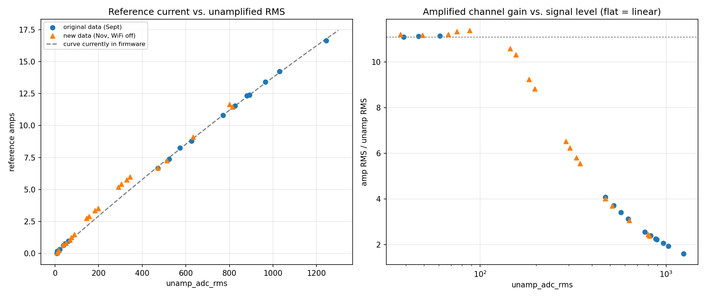

# ESP32 Outdoor AC Current and Power Monitor

A DIY energy monitor for the outdoor unit of a home air conditioner. A clamp-on current transformer (CT) feeds a custom single-supply op-amp front end, an ESP32 computes true RMS current in firmware, a calibration fit in Python converts ADC counts to amps, and estimated power is published over MQTT to Home Assistant.

The goal was to see how much power the AC actually draws, and how that changes with conditions like outdoor temperature, using a low-cost sensor instead of a commercial energy monitor.


## Highlights

- **Analog front end designed from scratch** on a single 5 V rail: input scaling, AC coupling, a lossy integrator to recover i(t) from the CT signal, re-biasing, buffering, and a second ~11x gain path for small currents.
- **True RMS in software**, so readings stay valid for non-sinusoidal loads such as motors and switch-mode supplies, not just clean sine waves.
- **Two-channel calibration** fit in Python against two reference meters, with leave-one-out error of **4.5% mean and 9.9% worst case** over about 0.3 A to 16.7 A (WiFi off).
- **Bench debugging with real data**: oscilloscope captures, waveform-generator tests, and cross-checks between firmware RMS values and scope measurements.
- **Home Assistant integration** over MQTT, used to look at AC power draw against outdoor temperature.

## How it works

```
CT clamp -> input divider -> AC coupling -> lossy integrator -> re-bias to 2.5 V
         -> unity buffer --+-> 2/3 divider ------------------> ESP32 ADC (GPIO34)  "unamplified"
                           +-> ~11x gain -> 2/3 divider -------> ESP32 ADC (GPIO35)  "amplified"

ESP32: sample both lines -> RMS in counts -> 5-measurement rolling window
       -> calibration to amps -> estimated voltage -> power
       -> serial log + MQTT publish (hvac/outdoor/power, about every 5.5 s)
```

### Analog front end

Every stage is centered on a buffered 2.5 V virtual ground (Vref), since there is no negative supply.

| Stage | Purpose |
|---|---|
| Vref (10k/10k divider + op-amp follower) | Stable mid-rail bias for all stages |
| Input divider (330 Ω / 100 Ω) | Scales the CT signal so ~15 to 18 A fits inside the op-amp swing |
| AC coupling (21 µF, 1k to Vref) | Blocks DC and re-centers on Vref. A small bias resistor avoids a large offset from op-amp input current |
| Lossy integrator (10k, 270k ∥ 0.1 µF) | The CT output tracks dI/dt, so integrating recovers the current waveform. The 270k caps DC gain at 27x so offsets cannot drift to a rail |
| Re-bias (20 µF, 1k to Vref) | Removes the integrator's small DC offset |
| Unity buffer | Low-impedance source for the next stages |
| Gain stage (~11x measured) | Extra resolution for small currents |
| 2/3 dividers | Map 0 to 5 V onto the ESP32's 0 to 3.3 V ADC range, centered near 1.65 V |

Op-amps are TI TL272s. The integrator was first built on an LM741, which could not swing close to its rails on a single 5 V supply and produced a compressed, lopsided output. Switching to a single-supply part fixed it. Full stage-by-stage reasoning is in [ac_current_monitor_handoff_v2.md](ac_current_monitor_handoff_v2.md).

### Firmware

Built with PlatformIO and the Arduino framework on a NodeMCU-32S.

- Samples both lines about 4,166 times per second each. One reading is 1,500 samples (about 21.6 cycles of 60 Hz), and three readings make one measurement.
- RMS per buffer is `sqrt(mean((x - mean(x))^2))`, which removes the DC bias.
- A 5-measurement rolling window combines mean squares (not RMS values) before taking one square root.
- Calibration is applied once to the finished RMS value, never to individual samples.
- Power is estimated as `(246.0 - 0.3067 * amps) * amps`, using a voltage-sag model from a measurement on the actual 240 V circuit.

| File | Role |
|---|---|
| `src/main.cpp` | Setup, WiFi, main measurement loop |
| `src/rms_current.cpp` | Sampling and RMS |
| `src/calibration.cpp` | ADC counts to amps, channel crossover |
| `src/power.cpp` | Voltage and power estimate |
| `src/mqtt_handler.cpp` | MQTT publishing |

Details: [firmware_state_adc_calibration.md](firmware_state_adc_calibration.md).

## Calibration

Known loads were measured with a Kill-A-Watt and a second meter (their average is the reference) while logging raw RMS from both ADC lines. Curves were fit in Python ([callibration/fit_calibration.py](callibration/fit_calibration.py)).

The current model uses both channels:

- **Below ~1.5 A:** a straight-line fit on the amplified channel, which is linear up to about 1.5 A.
- **~1.5 to 2.1 A:** a linear fade between channels.
- **Above ~2.1 A:** a weighted cubic fit on the unamplified channel.



A second round of measurements in November 2026 showed the original fit read 16 to 26% low between 2.8 and 6 A, because the first data set had a gap in that range. Refitting with the combined data cut the worst-case error from 25.7% to 9.9%.

| Range | Original fit (mean / max) | Current model, leave-one-out (mean / max) |
|---|---|---|
| 0.3 to 1.5 A | within ~8% | 3.0% / 7.1% |
| 1.5 to 6.5 A | 21% / 26% low | 7.9% / 9.9% |
| 6.5 A and up | 1.0% / 3.9% | 3.7% / 8.9% |
| All points ≥ 0.3 A | 6.7% / 25.7% | 4.5% / 9.9% |

Leave-one-out means each point is predicted by a fit that excluded it. The two reference meters disagree with each other by a median of about 1%, which sets a floor on how tight any claim can be. Method and data: [callibration/CALIBRATION_METHODOLOGY.md](callibration/CALIBRATION_METHODOLOGY.md).

## Results

Using data logged in Home Assistant, the AC's power draw rose by about 12 W per °F, from roughly 1,500 W at 51 °F to 1,900 W at 85 °F. See [analysis/ac_power_vs_outdoor_temp.md](analysis/ac_power_vs_outdoor_temp.md).

## Known limitations

- **WiFi noise.** With WiFi on there is a no-load noise floor of about 150 to 200 W. Scope captures show the 5 V rail dipping about 5 times per second with matching spikes on both signal lines. The working hypothesis is radio current bursts pulling down the rail that Vref is derived from. All accuracy figures above are with WiFi off. Captures are in [scope captures/](scope%20captures/).
- **Calibration not yet re-checked on the device.** The refit model matches the Python fit and builds, but has not been verified against independent loads on hardware. The fade region between channels has no measured points.
- **Power is estimated, not measured.** Voltage comes from a single-point sag model and power factor is not measured, so the output is closer to apparent power (VA) than real power.
- **Sampling is not timer-paced**, and a reading is not a whole number of 60 Hz cycles.
- Readings below about 0.3 A are not reliable.

## Next steps

- Verify the new calibration on the device against the reference meters.
- Fix the WiFi noise at the source: supply and Vref decoupling first, or move WiFi to a separate chip and supply, or sample while the radio is idle.
- Add calibration points between 1.5 and 6.5 A with recorded load types.
- Move sampling to a timer or DMA with whole-cycle windows.
- Measure voltage and phase to report real power.

## Repository layout

```
src/                        firmware (PlatformIO, Arduino framework)
callibration/               calibration data, fitting and accuracy scripts, plots
scope captures/             oscilloscope screenshots (WiFi on/off, loaded/unloaded)
analysis/                   AC power vs. outdoor temperature
PROJECT_OVERVIEW.md         full project summary
ac_current_monitor_handoff_v2.md     analog circuit design notes
firmware_state_adc_calibration.md    firmware and noise investigation notes
Test_plan.md, Project_plan.md        test plan and roadmap
```

## Building

1. Install [PlatformIO](https://platformio.org/).
2. Create `src/config.h` with your WiFi credentials, MQTT broker settings, and tuned constants (this file is not tracked).
3. Build and upload to a NodeMCU-32S: `pio run -t upload`.
4. Watch output with `pio device monitor`.

## Safety

This project clamps a sensor around a live 240 V conductor. The CT itself does not touch the conductor, but installing it means working inside a panel or disconnect. Do not attempt this unless you are qualified to work around mains wiring.

## License

MIT. See [LICENSE](LICENSE).
